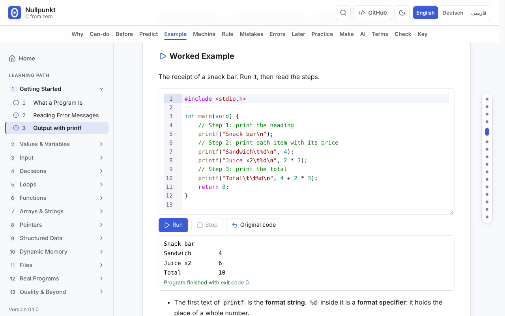
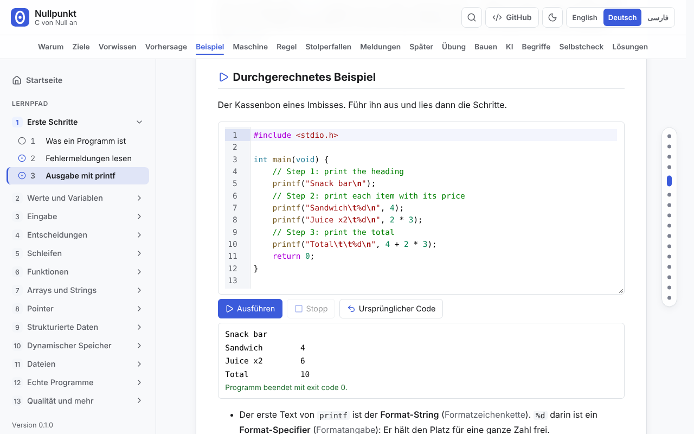
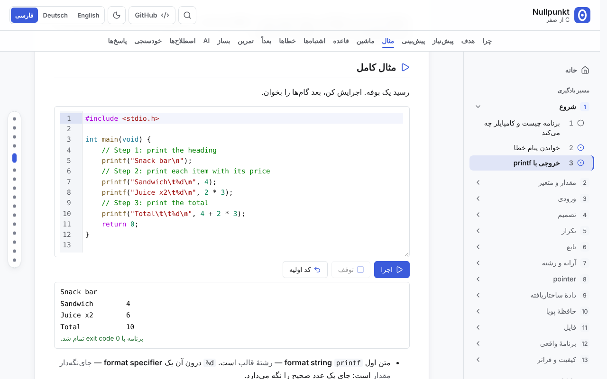

<p align="center">
  
</p>

<h1 align="center">Nullpunkt</h1>

<p align="center">
  <b>C from zero</b> · <b>C von Null an</b> · <b dir="rtl">C از صفر</b><br>
  <a href="https://mohsen-1984.github.io/Nullpunkt/">mohsen-1984.github.io/Nullpunkt</a>
</p>

<p align="center">
  <a href="https://github.com/mohsen-1984/Nullpunkt/releases/tag/v0.1.0"></a>
  <a href="https://github.com/mohsen-1984/Nullpunkt/actions/workflows/ci.yml"></a>
  
  
  
</p>

<p align="center"><a href="#english">English</a> · <a href="#deutsch">Deutsch</a> · <a href="#فارسی">فارسی</a></p>

---

## English

**Nullpunkt** is a free, self-study C course for first-year computer science students who start from zero. It is written in English, German and Persian; code, technical terms and compiler messages are always in English, the language you will meet everywhere else. Every example runs in your browser: a real C compiler, compiled to WebAssembly, on your own machine — offline, straight from `file://`, with nothing sent to a server.

**Why “Nullpunkt”?** *Nullpunkt* [ˈnʊlˌpʊŋkt] is German for *zero point*, the origin of a coordinate system. The word holds three meanings that belong to this course: **from zero** (no background assumed, not even the word *identifier*), **`NULL`** (the null pointer, the address zero where a C program must never write) and **counting from zero** (the first element of a C array has index 0). It is German because the course is made for students in Europe, it reads well in English and Persian too, and it is not tied to C, so C++ will fit under the same name later. The logo is the dotted zero that code fonts draw to tell `0` from `O`.



- **Predict, run, look inside.** Every lesson follows the same path: predict the output, run the worked example, see what the machine does, learn the rule.
- **Mistakes are part of the lesson.** Every common mistake has a code (`E-03`, `U-01`, …), its real gcc message beside the browser compiler's, and an exercise.
- **Exercises checked by tests,** in the page; your progress stays in your browser.
- **Find anything:** press <kbd>/</kbd> or <kbd>Ctrl</kbd> <kbd>K</kbd> to search every lesson, term and mistake.

**Status (0.1.0):** chapter 1 (lessons 1–3) is written; 13 chapters and 50 lessons are planned for 1.0. C++ comes after.

## Deutsch

**Nullpunkt** ist ein freier C-Kurs zum Selbstlernen für Informatik-Erstsemester, die bei null anfangen. Er ist auf Deutsch, Englisch und Persisch geschrieben; Code, Fachbegriffe und Compiler-Meldungen bleiben immer englisch — so, wie du ihnen überall sonst begegnest. Jedes Beispiel läuft in deinem Browser: ein echter C-Compiler als WebAssembly, auf deinem eigenen Rechner — offline, direkt von `file://`, ohne dass etwas an einen Server geht.

**Warum „Nullpunkt“?** Der Nullpunkt ist der Ursprung eines Koordinatensystems. Das Wort trägt drei Bedeutungen, die zu diesem Kurs gehören: **von null an** (nichts wird vorausgesetzt, nicht einmal das Wort *Identifier*), **`NULL`** (der Null-Pointer, die Adresse null, an die ein C-Programm nie schreiben darf) und **ab null zählen** (das erste Element eines C-Arrays hat den Index 0). Ein deutsches Wort, weil der Kurs für Studierende in Europa gemacht ist; es liest sich aber auch auf Englisch und Persisch gut, und es ist nicht an C gebunden — C++ hat später unter demselben Namen Platz. Das Logo ist die Null mit Punkt, mit der Code-Schriften `0` von `O` unterscheiden.



- **Vorhersagen, ausführen, hineinschauen.** Jede Lektion geht denselben Weg: Ausgabe vorhersagen, Beispiel ausführen, sehen, was die Maschine tut, die Regel lernen.
- **Fehler gehören zur Lektion.** Jeder typische Fehler hat einen Code (`E-03`, `U-01`, …), die echte gcc-Meldung neben der des Browser-Compilers und eine Übung.
- **Übungen, geprüft von Tests** auf der Seite; dein Fortschritt bleibt in deinem Browser.
- **Alles finden:** <kbd>/</kbd> oder <kbd>Strg</kbd> <kbd>K</kbd> durchsucht jede Lektion, jeden Begriff und jeden Fehler.

**Stand (0.1.0):** Kapitel 1 (Lektionen 1–3) ist geschrieben; für 1.0 sind 13 Kapitel und 50 Lektionen geplant. C++ folgt danach.

## فارسی

<div dir="rtl">

**Nullpunkt** (نول‌پونکت) دورهٔ رایگان و خودآموز زبان C برای دانشجوی سال اول علوم کامپیوتر است که از صفر شروع می‌کند. دوره به فارسی، آلمانی و انگلیسی نوشته شده؛ کد، اصطلاح‌های فنی و پیام‌های compiler همیشه انگلیسی می‌مانند، همان‌طور که همه‌جای دیگر با آن‌ها روبه‌رو می‌شوی. هر مثال در مرورگر خودت اجرا می‌شود: یک compiler واقعی C که به WebAssembly ترجمه شده، روی کامپیوتر خودت — آفلاین، مستقیم از `file://`، بی‌آنکه چیزی به سروری فرستاده شود.

**چرا «Nullpunkt»؟** Nullpunkt در آلمانی یعنی «نقطهٔ صفر»، مبدأ یک دستگاه مختصات. این واژه سه معنا دارد که هر سه به این دوره مربوط‌اند: **از صفر** (هیچ پیش‌زمینه‌ای فرض نمی‌شود، حتی واژهٔ identifier)، **`NULL`** (null pointer، آدرس صفر، جایی که برنامهٔ C هرگز نباید در آن بنویسد) و **شمارش از صفر** (اولین عنصر یک array در C اندیس 0 دارد). واژه آلمانی است چون دوره برای دانشجوی اروپا ساخته شده، ولی در انگلیسی و فارسی هم خوب خوانده می‌شود؛ و به C گره نخورده، پس C++ هم بعداً زیر همین نام جا می‌گیرد. نشان دوره همان صفرِ نقطه‌دار است که قلم‌های کد برای جدا کردن `0` از `O` می‌کشند.



- **پیش‌بینی، اجرا، نگاه به درون.** همهٔ درس‌ها یک مسیر را می‌روند: خروجی را پیش‌بینی کن، مثال را اجرا کن، ببین ماشین چه می‌کند، قاعده را یاد بگیر.
- **اشتباه بخشی از درس است.** هر اشتباه رایج یک کد دارد (`E-03`، `U-01`، …)، پیام واقعی gcc را کنار پیام compiler مرورگر نشان می‌دهد و یک تمرین دارد.
- **تمرین‌هایی که تست‌ها بررسی‌شان می‌کنند،** همان‌جا در صفحه؛ پیشرفتت در مرورگر خودت می‌ماند.
- **پیدا کردن هر چیز:** <kbd>/</kbd> یا <kbd>Ctrl</kbd> <kbd>K</kbd> همهٔ درس‌ها، اصطلاح‌ها و اشتباه‌ها را جست‌وجو می‌کند.

**وضعیت (نسخهٔ 0.1.0):** فصل 1 (درس‌های 1 تا 3) نوشته شده؛ برای نسخهٔ 1.0، 13 فصل و 50 درس برنامه‌ریزی شده است. C++ پس از آن می‌آید.

</div>

---

## Using it

- **Online:** [mohsen-1984.github.io/Nullpunkt](https://mohsen-1984.github.io/Nullpunkt/).
- **Offline:** download the repository (Code → Download ZIP), unpack it and open `index.html`. Everything except the fonts is in the folder; without a network the page falls back to your system fonts.
- **Release notes:** [`CHANGELOG.md`](CHANGELOG.md) · [releases](https://github.com/mohsen-1984/Nullpunkt/releases/tag/v0.1.0). Open work: [`TODO.md`](TODO.md).

## Repository

| Folder | What it holds |
|---|---|
| [`docs/`](docs/) | The rule documents: series bible, pedagogy, data schema, assets, C conventions |
| [`data/`](data/) | The course itself, as data: catalog, glossary, prompts, mistakes, chapters; `data/generated/` holds real compiler results |
| [`site/`](site/) | The pages' scripts and styles: config, chrome (header, drawer, rail, scroll-spy), search, home, lesson |
| [`lib/`](lib/) | `CRunner.js` and `WasiShim.js` (compile and run C in the browser), `Data.js`, `Inline.js`, `CodeScan.js`, `Search.js` |
| [`assets/`](assets/) | Logo, favicon, link-preview picture, screenshots |
| [`vendor/`](vendor/) | Third-party parts, built by `tools/`: XCC, CodeMirror, Lucide icons |
| [`tools/`](tools/) | The checker, result generator, build scripts, browser tests, `og-image.html`, the runner lab |
| [`tests/`](tests/) | Runner lab programs with gcc's results; search tests |

`index.html` is the home page; `lesson.html?lesson=C.L01&lang=en` opens a lesson (`de`, `fa`). Each folder has its own README.

## Writing lessons

Content lives only in `data/`. After a change:

```sh
node tools/gen-expect.js        # compile and run every code record and test with gcc and XCC
node tools/check.js             # every checkable rule — must report 0 errors, 0 warnings
node tools/headless-lesson.js   # use each lesson in headless Chrome, in every language
node tools/headless-shell.js    # the site shell at 15 widths × 3 languages, drawer and search
```

CI runs these and more on every pull request (`.github/workflows/ci.yml`).

## License

- **Content** (lessons, exercises, rule documents, logo): [CC BY-SA 4.0](LICENSE-CONTENT.md)
- **Code**: [MIT](LICENSE)
- **Third-party components** keep their own licenses: [`THIRD-PARTY-NOTICES.md`](THIRD-PARTY-NOTICES.md)

## Contact

mohsen-1984 · mhn.com@gmail.com
